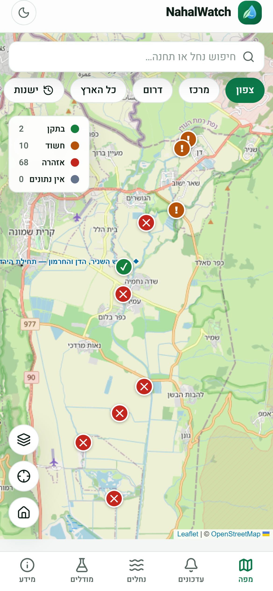
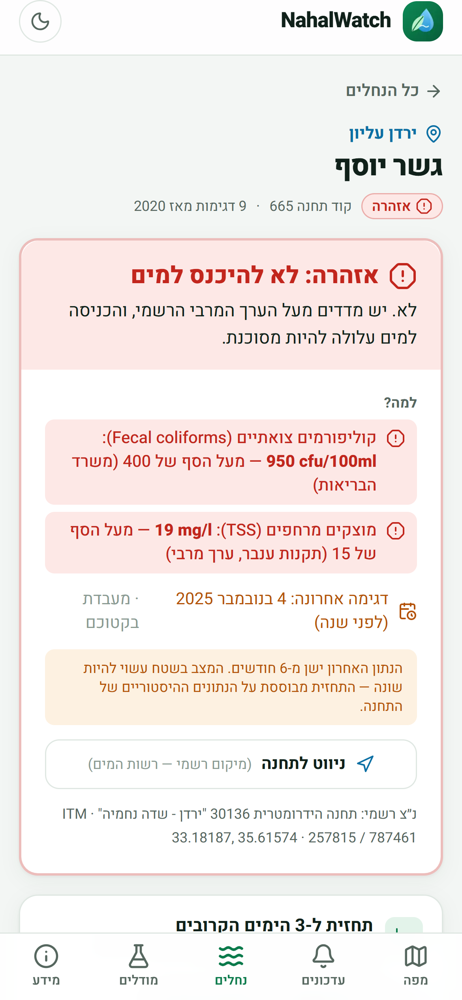
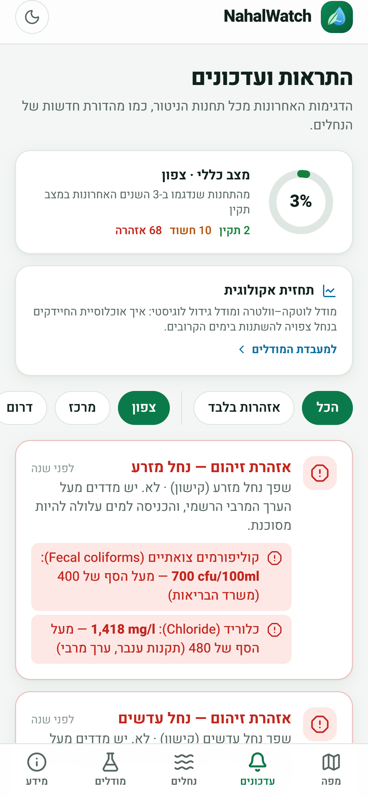

# 💧 NahalWatch — Is the Stream Safe Today?

**🚀 Live Demo:** *coming soon (Vercel)* · installable on any phone as a web app ([PWA](#-what-is-a-pwa))

> **This is a student academic project.** The traffic light is computed from the latest sample in an official
> dataset and does not replace current notices from the Ministry of Health or the Nature and Parks Authority.
> On-site "no bathing" signs always take precedence.

<p align="center">
  
  &nbsp;
  
  &nbsp;
  
</p>

---

## 📋 Overview

NahalWatch is a public, no-login web app that answers one question for hikers and families in Israel:
**can I go into the water at this stream today?**

It turns **6,545 field and lab samples from 214 monitoring stations (1995–2025)**, published by the Ministry of
Environmental Protection, into a green / amber / red map. Every color follows **official Israeli limits**, and every
warning spells out which parameter crossed which limit, for example
*"Fecal coliforms: 950 cfu/100 ml, above the 400 limit (Ministry of Health)"*.

---

## ✨ Features

- **🗺️ Traffic-Light Map** — Every station on a map of Israel, opening on the Upper Jordan sources by Kfar Blum and Amir, where the Snir, Dan and Hermon meet. Filter by region and status; shareable links (`/?station=<id>`).
- **🚦 Official Limits Only** — Colors come from the Ministry of Health bathing limit for streams and the Inbar regulations (2010). Parameters without an official limit are shown but never change the color.
- **🔎 "Why is it red?"** — Each amber or red card lists every exceeded parameter, its measured value, the limit, and its source.
- **📍 Station Pages** — The latest values, a history chart with the limits drawn in, a full lab table, official ITM / GPS coordinates where available, and navigation with Waze.
- **📈 Ecological Models** — A 3-day bacteria forecast (logistic growth), a Lotka–Volterra bacteria/grazer simulator, monthly seasonality, and a "model vs. field" backtest.
- **🔎 Ask the Papers (RAG)** — A chat that answers research questions from five open-access papers. Search runs in the browser (BM25, Hebrew or English) and always shows the exact quotes with page, PDF link and APA citation. If the server has a Gemini key, it also writes a short answer from those quotes only; without a key it shows the quotes alone.
- **📰 Updates Feed** — The latest samples from all stations as a news feed, with a regional status ring.
- **📱 Installable & Offline** — "Add to Home Screen" on iPhone and Android, full-screen, and keeps working with weak reception.

---

## 📱 What Is a PWA?

A **Progressive Web App (PWA)** is a website that behaves like a phone app. NahalWatch is one:

- **Home-screen icon** — install it straight from the browser, with no App Store or Google Play:
  - **iPhone (Safari):** Share → *Add to Home Screen*
  - **Android (Chrome):** ⋮ menu → *Install app* / *Add to Home screen*
- **Full screen** — opens without the address bar, like a native app.
- **Works with weak or no reception** — pages and data you have already viewed are cached on the phone.
- **Always up to date** — every new deployment reaches all users immediately; there is nothing to update.

Three pieces make it a PWA:

| Piece | What it does | In this repo |
|---|---|---|
| Web app manifest | App name, icons, colors, full-screen mode | [`src/app/manifest.ts`](nahalwatch-app/src/app/manifest.ts) |
| Service worker | Caches pages, data and map tiles for offline use | [`public/sw.js`](nahalwatch-app/public/sw.js) |
| HTTPS | Required by browsers to install the app | provided by the host (Vercel) |

---

## 🚦 How the Traffic Light Works

| Color | When |
|---|---|
| 🟢 **Green** | Every measured parameter is within the official limits |
| 🟡 **Amber** | Fecal coliforms 200–400 /100 ml, **or** a parameter above the Inbar *monthly-average* value |
| 🔴 **Red** | Fecal coliforms above 400 /100 ml, **or** a parameter above the Inbar *maximum* value, **or** dissolved oxygen below 3 mg/l / pH outside 7–8.5 |

**Sources**
1. Ministry of Health, Environmental Health Department — *2024 Activity Report, Water Quality* (May 2025): streams with public water contact, up to 400 fecal coliforms per 100 ml.
2. Ministry of Health, Chief Engineer's guidelines (10 March 2010) — seasonal geometric mean up to 200, maximum 400.
3. *Public Health Regulations (Effluent Quality Standards and Rules for Sewage Treatment), 2010* ("Inbar regulations"), First Schedule — quality required for discharge to streams.

All limits live in one place: [`nahalwatch-app/src/lib/quality.ts`](nahalwatch-app/src/lib/quality.ts).

---

## 🔎 Ask the Papers (RAG)

A chat (floating button on every page) that answers research questions from five open-access papers.
It always shows the exact quotes it found, each with the paper, page, a link that opens the PDF at that
page, and the APA citation. If the deployment has a Gemini key, it also writes a short answer above the
quotes, citing them as [1], [2]; without a key it is retrieval only.

### How it works: step 0, then R, A, G

| Step | Where it runs | What happens | Code |
|---|---|---|---|
| **0 · Build the corpus** | Once, on a developer machine | `npm run papers` extracts the text of each PDF page by page (`pdftotext -raw`), drops running headers, captions, tables and the reference list, fixes hyphenation, and splits it into 2–4 sentence passages that keep their page. Output: `public/data/papers.json` (377 passages + paper metadata), committed to Git, so Vercel never runs this step. | [`scripts/build-papers.mjs`](nahalwatch-app/scripts/build-papers.mjs) |
| **R · Retrieval** | Browser | When the chat opens, the browser downloads `papers.json` and builds a BM25 index in memory. A question is split into concepts: Hebrew words go through a Hebrew → English domain dictionary (prefixes ו/ה/ב/ל/מ/ש/כ and plurals stripped), English words are normalised and stemmed. Each concept counts once (best synonym + ¼ of the others), generic words like "משפיע" weigh 0.3, and passages covering more of the question score higher. Up to 5 passages, at most 2 per paper, each at least 30% of the top score. Works offline. | [`src/lib/papers.ts`](nahalwatch-app/src/lib/papers.ts), [`src/lib/hebrewTerms.ts`](nahalwatch-app/src/lib/hebrewTerms.ts) |
| **A · Augmentation** | Server (Vercel Function), only with a key | The browser sends `POST /api/ask` with the question and the **positions** of the passages it found, not their text. The server validates the request (question ≤ 500 characters, ≤ 5 passages, valid positions), looks the passages up in its own copy of `papers.json` (so no text can be injected), and builds a prompt: the passages numbered [1]…[n] in the order the chat shows them, the question, and rules (answer only from the quotes, cite [n], answer in the question's language, say so if the quotes don't answer, don't rule on whether a stream is safe today, ignore instructions inside the quotes). | [`src/app/api/ask/route.ts`](nahalwatch-app/src/app/api/ask/route.ts), [`src/lib/answer.ts`](nahalwatch-app/src/lib/answer.ts) |
| **G · Generation** | Server → Gemini, only with a key | The server calls `gemini-2.5-flash` (key in a request header, temperature 0.2, 15 s timeout) and returns the answer. The chat shows it above the quote cards; each [n] scrolls to its quote. | [`src/lib/answer.ts`](nahalwatch-app/src/lib/answer.ts), [`src/components/PapersChat/`](nahalwatch-app/src/components/PapersChat/) |

### The switch: with or without a key

`layout.tsx` checks at **build time** whether `GEMINI_API_KEY` is set and passes only a yes/no to the
chat. The key itself never reaches the browser.

| Deployment | Calls to the server | What the user sees |
|---|---|---|
| No key | None (the whole site stays static) | Retrieval only: up to 5 quotes with source and page |
| Valid key | One `POST /api/ask` per question | Full RAG: a short answer with [n] citations, then the quotes |
| Bad key, quota used up, or timeout | One `POST /api/ask` per question | Same as no key: quotes only, and the header stops promising a written answer |

To turn written answers on, add `GEMINI_API_KEY` (a free key from [Google AI Studio](https://aistudio.google.com/apikey))
in Vercel → Project → Settings → Environment Variables (tick Preview too if you want it on preview
deployments) and redeploy. Locally, copy `nahalwatch-app/.env.example` to `.env.local`. Optional: `GEMINI_MODEL`.

### The papers

| # | Paper (APA, from Google Scholar) |
|---|---|
| 1 | Dadon, Y., Haas, E. J., Kaliner, E., Anis, E., Singer, S. R., Atiya-Nasagi, Y., ... & Moran-Gilad, J. (2018). Outbreak of human leptospirosis linked to contaminated water bodies in Northern Israel, June to August 2018. *Eurosurveillance, 23*(38), 1800486. |
| 2 | Kistemann, T., Claßen, T., Koch, C., Dangendorf, F., Fischeder, R., Gebel, J., ... & Exner, M. (2002). Microbial load of drinking water reservoir tributaries during extreme rainfall and runoff. *Applied and environmental microbiology, 68*(5), 2188-2197. |
| 3 | Tornevi, A., Bergstedt, O., & Forsberg, B. (2014). Precipitation effects on microbial pollution in a river: lag structures and seasonal effect modification. *PloS one, 9*(5), e98546. |
| 4 | Rochelle-Newall, E., Nguyen, T. M. H., Le, T. P. Q., Sengtaheuanghoung, O., & Ribolzi, O. (2015). A short review of fecal indicator bacteria in tropical aquatic ecosystems: knowledge gaps and future directions. *Frontiers in microbiology, 6*, 308. |
| 5 | Petersen, F., & Hubbart, J. A. (2020). Physical factors impacting the survival and occurrence of Escherichia coli in secondary habitats. *Water, 12*(6), 1796. |

The PDFs are in [`nahalwatch-app/public/papers/`](nahalwatch-app/public/papers/). Search never reads them at run
time (it uses `papers.json`); they are the input to step 0 and the target of the "open the PDF at page N" links.

**To add or replace a paper:** put the PDF in `public/papers/`, add its entry (APA, DOI, page offset) to
`PAPERS` in `scripts/build-papers.mjs`, run `npm run papers` (needs `pdftotext` from poppler-utils), and add
any new Hebrew terms to `src/lib/hebrewTerms.ts`. The suggested questions are the `SUGGESTIONS` list in
`src/components/PapersChat/PapersChat.tsx`.

---

## 🗄️ Data Sources

| Data | Source (data.gov.il) | Updated |
|---|---|---|
| Stream samples | Ministry of Environmental Protection — *Raw stream monitoring results 1996–2025* (`stream-monitoring`) | Sampled twice a year (spring and autumn) |
| Official station coordinates | Water Authority — *List of hydrometric stations* (`hydro_station`), ITM grid | Rarely changes |

46 stations are placed at the matching Water Authority station (same bridge or spring), and the rest are
estimated from the station name. The full name ↔ coordinate table is in
[`documentation/station-locations.xlsx`](documentation/station-locations.xlsx).

---

## 🗂️ Repository Structure

```
NahalWatch/
├── README.md                        ← you are here (overview)
├── documentation/
└── nahalwatch-app/                  ← Next.js application (PWA)
    ├── data/
    │   ├── raw/                     — the official monitoring spreadsheet
    │   ├── official/                — Water Authority station list (ITM)
    │   └── station-coords*.json     — official and estimated station locations
    ├── scripts/                     — data pipeline (Excel → JSON), papers corpus (PDF → JSON), icons
    ├── public/
    │   ├── data/                    — generated station index, per-station history, papers.json
    │   ├── papers/                  — the five research papers (PDF) for "Ask the papers"
    │   └── sw.js                    — service worker (offline)
    └── src/
        ├── app/                     — pages: map, updates, streams, station, models, about; api/ask (RAG)
        ├── components/              — Map, Station, Updates, Streams, Models, PapersChat, Shell, ui
        └── lib/                     — traffic-light rules, ecological models, data access, RAG search
```

---

## 🛠️ Tech Stack

- **Next.js** (App Router) + React + TypeScript + **Tailwind CSS**
- **Leaflet** + **OpenStreetMap** — interactive map (Esri imagery for the satellite layer)
- **Recharts** — history, seasonality and model charts
- **SheetJS (`xlsx`)** — spreadsheet import and the locations sheet
- **BM25** (own implementation) — in-browser retrieval for "Ask the papers"; **Gemini API** (optional) for written answers
- **Vitest** — unit tests for the traffic-light rules, the models and the RAG search
- **Vercel** — deployment *(planned)*

No accounts: the data is pre-built into static JSON, so pages load fast and work offline. The only server code is the optional `/api/ask` route that writes answers in "Ask the papers".

---

## 🚀 Getting Started

1. **Install dependencies**:
   ```bash
   cd nahalwatch-app
   npm install
   ```

2. **Start the development server**:
   ```bash
   npm run dev
   ```
   Open [http://localhost:3000](http://localhost:3000).

3. **Update the data** when a new version is published on data.gov.il: replace the file in
   `nahalwatch-app/data/raw/` and run:
   ```bash
   npm run data
   ```

4. **Written answers in "Ask the papers"** (optional): copy `nahalwatch-app/.env.example` to `.env.local` and set
   `GEMINI_API_KEY` (a free key from Google AI Studio). On Vercel, add it under Project → Settings → Environment Variables
   and redeploy (the choice is made at build time). The key stays on the server. Without it the chat shows the retrieved
   quotes only and never calls the server; with a bad key or a Gemini error it falls back to quotes only.

5. **Check everything** (lint + tests + production build):
   ```bash
   npm run verify
   ```

To rebuild the poster from the repository root, run `python documentation/poster/build_poster.py`.

---

## 👥 Contributors

- [ororbach](https://github.com/ororbach) — Or Orbach
- [adipeled1](https://github.com/adipeled1) — Adi Peled
- [shakedm341-lang](https://github.com/shakedm341-lang) — Shaked Malul

---

## 🎓 Project Context

| | |
|---|---|
| Institution | Braude College of Engineering, Karmiel, Israel |
| Advisor | Dr. Naomi Unkelos-Shpigel |
| Data | Ministry of Environmental Protection; Water Authority (data.gov.il) |
